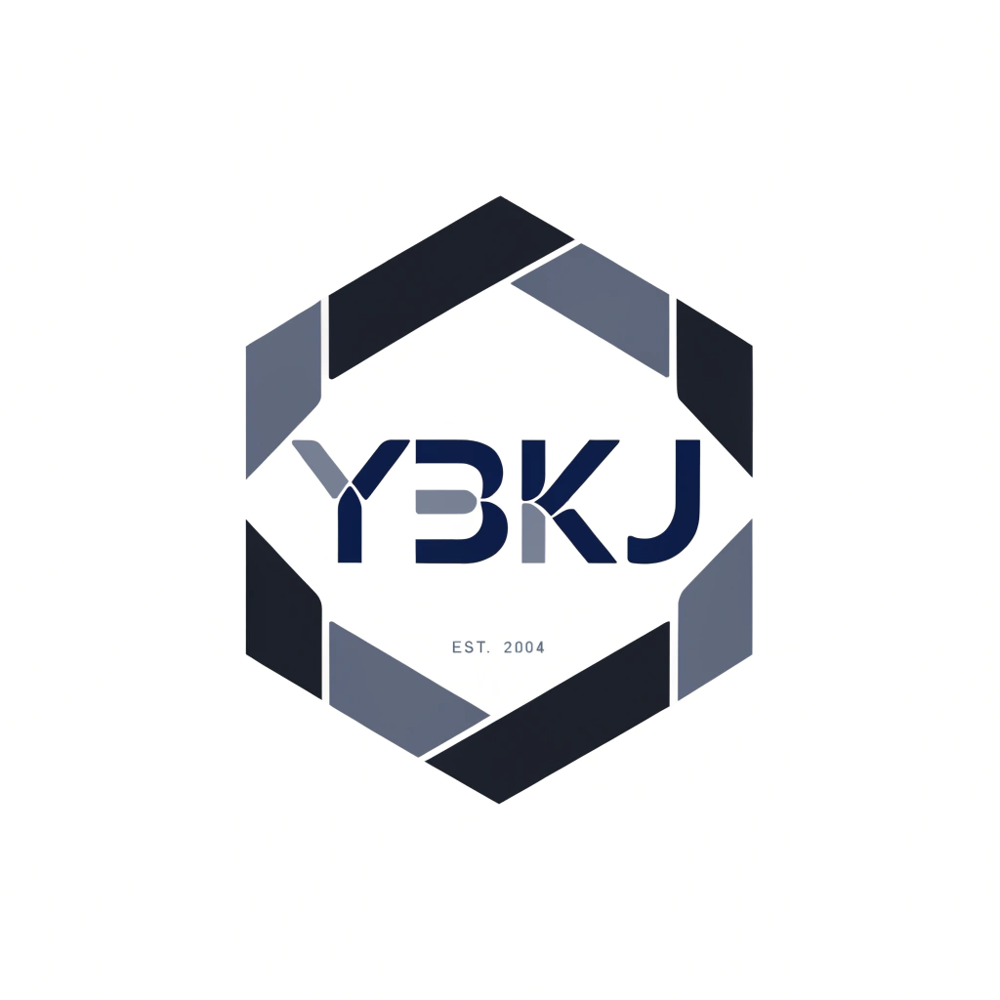

<h1 align="center">YBKJ-WorkFlow｜维保日报通</h1>

<a href="README.md">简体中文</a> · <strong>English</strong>

Local-first maintenance records, human review and daily-report workflow

[Copyright and authorization](COPYRIGHT.md) · [Security policy](SECURITY.md)

## Overview

Authorized text and manual entries flow through a raw-input pool, rule-based parsing, human review and quality checks before producing trusted reports and ledgers.

## Version and actual status

**app/version.py: V0.8-windows-build-test**. CHANGELOG records V0.8.1-windows-build-fix and historical Windows 11 source startup, packaging, self-check and GUI startup results. Runtime version metadata has not been aligned with the hotfix name. Formal release and production acceptance are unverified. No runtime version change or build rerun here.

[Pinned source](https://github.com/usydin/YBKJ-WorkFlow/tree/589f5882df1a7c5c0317d6af17db874c61e58fb0) · [Original README (historical)](https://github.com/usydin/YBKJ-WorkFlow/blob/589f5882df1a7c5c0317d6af17db874c61e58fb0/README.md)

## Capabilities

- Raw-input pool, rule parsing, staff mapping and correction audit.
- Confirmed records only for daily reports, statistics and Excel; TXT/Markdown and multi-sheet export.
- Read-only quality checks, OCR staging and mock research; real OCR, model training and automatic enterprise messaging are not integrated.

## Architecture

Python, PySide6, SQLite + JSONL and openpyxl; PyInstaller Windows portable delivery. macOS is a development/target environment, not a confirmed formal delivery.

## Safety and data

Public visibility is not an open-source license. Do not disclose raw chats, employee mappings, reports, customer ledgers, databases, OCR images or credentials. Use synthetic/sanitized data and human review. Historical public data and rights require separate audit.

## Documentation

- [Changelog](CHANGELOG.md)
- [Architecture](docs/技术架构说明.md)
- [Workflow validation](docs/全流程验证说明.md)
- [Windows test record](docs/WINDOWS_BUILD_TEST_RECORD.md)
- [Data contracts](docs/数据池字段说明.md)

## Developer identity

**SNTL Lab** · Preserve original developer ybkj-pL and current YBKJ maintenance department attribution. SNTL Lab is the industrial R&D identity. Historical copyright differences remain subject to rights review.
